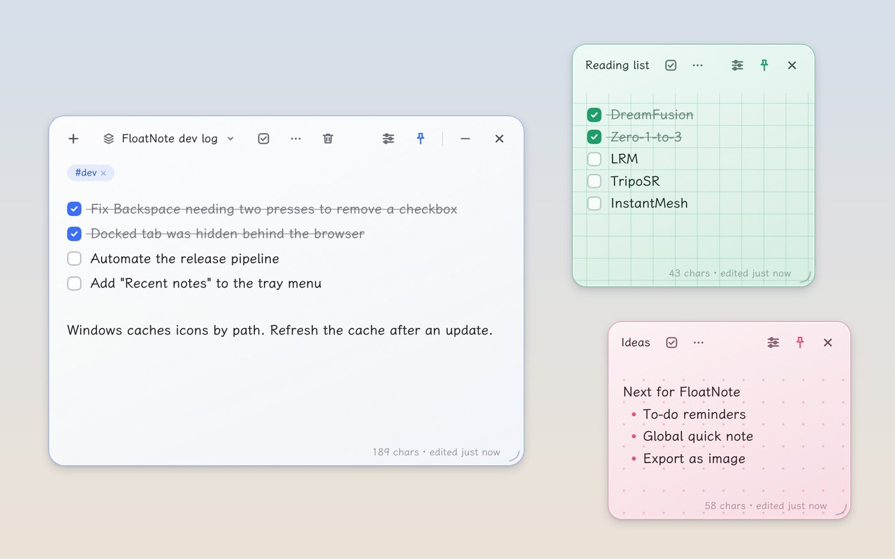
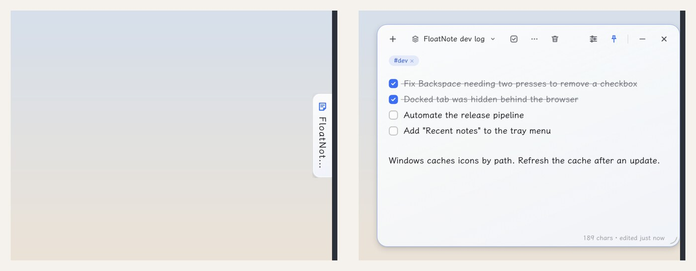
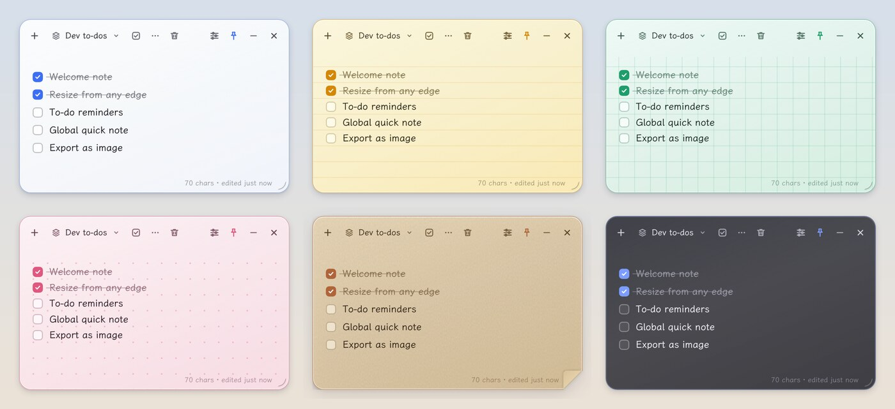
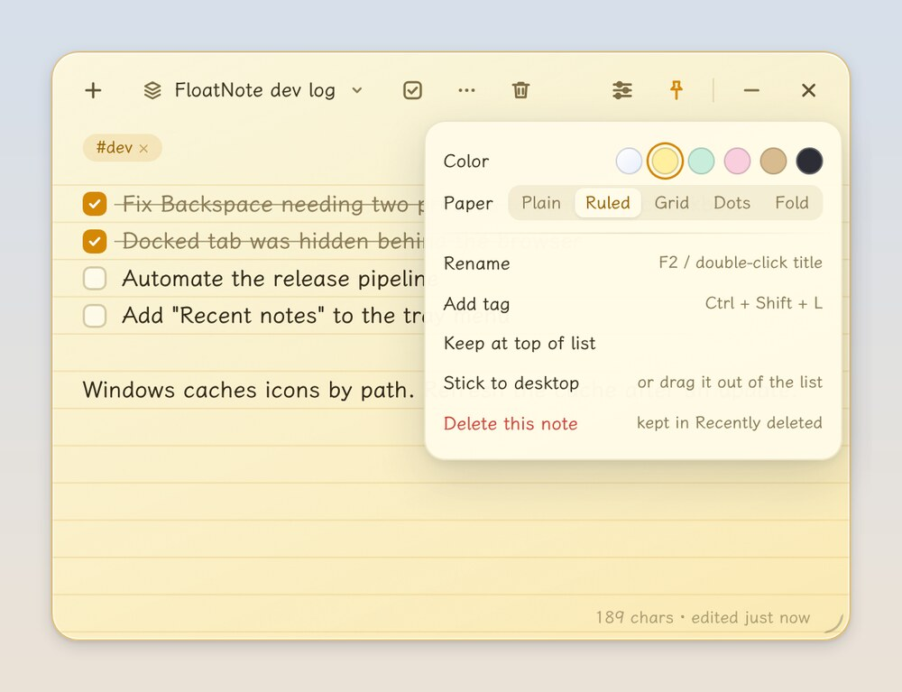

<p align="center">
  
</p>

<h1 align="center">FloatNote</h1>

<p align="center">
  A translucent sticky note that floats on your desktop.<br>
  Jot things down, summon it with a hotkey, tuck it against the screen edge when you're done.
</p>

<p align="center">
  <a href="https://github.com/ttzttztt/FloatNote/releases/latest"></a>
  <a href="https://github.com/ttzttztt/FloatNote/releases"></a>
  
  <a href="LICENSE"></a>
</p>

<p align="center"><b>English</b> | <a href="README.zh-CN.md">简体中文</a></p>



## Highlights

- **One keystroke away.** `Ctrl+Alt+Space` shows or hides FloatNote from any app. It lives in the tray, not the taskbar.
- **To-dos, lists, images and links in one note.** Type `[] `, `- ` or `# ` at the start of a line and it turns into a to-do, a list or a heading.
- **Stick notes to the desktop.** Tear any note out of the notebook and it becomes its own small window that remembers where you put it.
- **Edge docking.** Drag a note to the edge of the screen and it folds into a thin tab. Touch the tab and it slides back out.
- **Quick capture.** Select text in any app, press `Ctrl+Alt+C`, and it lands in the current note with its source and time.
- **Six colors, five papers.** Glass, yellow, mint, pink, kraft or dark; plain, ruled, grid, dotted or dog-eared. Each note has its own.
- **Local-first.** Notes stay on your computer. Daily backups, a 30-day trash, and optional sync through any cloud folder you already use.
- **Updates itself.** The installed version downloads new releases in the background.
- **English and Chinese.** The interface follows your system language, and you can switch it in Settings.

## Download

Get the latest build from [Releases](https://github.com/ttzttztt/FloatNote/releases/latest):

| System | File | Notes |
| --- | --- | --- |
| Windows (recommended) | `FloatNote-Setup-x.y.z.exe` | Installer. Updates automatically. |
| Windows, portable | `FloatNote-x.y.z-portable.exe` | Runs without installing. No automatic updates. |
| Linux | `FloatNote-x.y.z-x86_64.AppImage` | Make it executable, then run it. |

The installer is not code-signed, so Windows may show "Windows protected your PC" on first run. Click **More info**, then **Run anyway**.

On first launch you get a welcome note with a short checklist that walks you through the main features.

macOS builds are not published or tested. The project can be built from source there (`pnpm dist:mac`), but expect rough edges.

## Features

### Writing

- **Markdown-style shortcuts** at the start of a line: `[] ` makes a to-do, `[x] ` a checked one, `- ` a bullet list, `1. ` a numbered list, `# ` and `## ` headings.
- **To-dos**: the toolbar button or `Ctrl+Shift+T` converts the current line or every selected line, and converts it back. Enter continues the list; Enter on an empty to-do leaves it. Checking an item off sets off a small burst of dots.
- **Images**: paste with `Ctrl+V`. Anything longer than 1920 px on its long side is scaled down and stored as WebP, so a 4K screenshot shrinks from about 8 MB to about 0.5 MB. GIFs are kept as they are.
- **Clean paste**: content from web pages and Word keeps its structure (paragraphs, headings, lists, bold, links) and drops fonts, colors and backgrounds. `Ctrl+Shift+V` pastes plain text.
- **Links**: URLs become links as you type. `Ctrl`+click opens them in your browser.
- **Undo and redo** cover everything, including to-do toggles, indentation, pastes and captures. Each note has its own history.
- **Tags**: hover a note and click **+ Tag**, or press `Ctrl+Shift+L`.

### Notes on your desktop



- **Stick to desktop**: from the note's **⋯** menu, or by dragging a note out of the switcher list. Each desktop note remembers its position, size and pin state across restarts. All windows edit the same data and stay in sync.
- **Edge docking**: drag the notebook or a desktop note to the left, right or top edge. It collapses into a tab when the pointer leaves and expands when the pointer returns. Docked tabs stay above other windows and never overlap each other.
- **Always on top**: the pin button keeps a window above everything else, including your browser. The notebook and each desktop note remember their own setting.
- **Quick capture**: on Windows the selected text is copied for you and your clipboard is restored afterwards. On other systems, copy first, then press the hotkey.
- **Resize from any edge or corner**; drag the toolbar to move.

### Look and feel



- **Colors and paper are per note**, set from the note's **⋯** menu. On ruled, grid and dotted paper, text sits on the lines.
- **Appearance** can follow the system dark mode or the time of day (warmer in the morning, dark at night).
- **Quiet by default**: the toolbar fades out when the pointer leaves the note, so only your text remains. This can be turned off.
- **Adjustable** font size (12–22 px) and background opacity.
- **Language**: English or Simplified Chinese. It follows the system language by default; change it under Settings → Language. The tray menu, dialogs and notifications switch with it.
- Bundled font: [LXGW WenKai Screen](https://github.com/lxgw/LxgwWenKai-Screen), a handwriting-style typeface that suits a paper note.



### Organizing

- **Switcher** (`Ctrl+F`): search titles, text and tags. Each entry shows its color, a preview, to-do progress and when it was last edited.
- **Favorites and order**: star a note to keep it at the top of the list; drag entries to reorder.
- **Titles** default to the first line of the note. Double-click the title or press `F2` to set your own.
- **Trash**: deleted notes are kept for 30 days and can be restored or removed for good. Deleting also shows an Undo prompt.
- Empty notes are cleaned up automatically.

### Safety net

- **Automatic saving** of everything: text, tags, check state, window position and size.
- **Daily backups**, kept for 7 days. **Restore from backup** in the tray menu brings one back, after saving a copy of the current data.
- If the data file is ever corrupted, FloatNote restores the latest backup on its own and keeps the damaged file for inspection.

## Keyboard shortcuts

| Action | Shortcut |
| --- | --- |
| Show or hide FloatNote | `Ctrl+Alt+Space` |
| Quick capture selected text | `Ctrl+Alt+C` |
| New note | `Ctrl+N` |
| Search and switch notes | `Ctrl+F` |
| Rename note | `F2` or double-click the title |
| To-do on or off | `Ctrl+Shift+T` |
| Bullet list / numbered list | `Ctrl+Shift+8` / `Ctrl+Shift+7` |
| Indent / outdent | `Tab` / `Shift+Tab` |
| Add tag | `Ctrl+Shift+L` |
| Undo / redo | `Ctrl+Z` / `Ctrl+Y` |
| Paste as plain text | `Ctrl+Shift+V` |
| Open link | `Ctrl`+click |

The two global hotkeys can be changed in Settings. If a default is already taken by another program on first launch, FloatNote falls back to `Ctrl+Shift+Space` or `Ctrl+Alt+F9` for show/hide, and `Ctrl+Shift+Alt+C` or `Ctrl+Alt+F10` for capture.

## Where your notes live

FloatNote runs entirely on your computer. There is no server and no account.

| What | Where | Follows a sync folder |
| --- | --- | --- |
| Notes (`data.json`) and images (`images/`) | The **data folder**. Settings shows its full path and lets you move it. | Yes |
| Per-computer settings (window positions, desktop notes, hotkeys), daily backups | The **local folder** | No |

The local folder, which is also the default data folder:

| System | Path |
| --- | --- |
| Windows | `%APPDATA%\floatnote\` |
| macOS | `~/Library/Application Support/floatnote/` |
| Linux | `~/.config/floatnote/` |

### Sync across computers

Point the data folder on each computer at the same folder inside OneDrive, Dropbox, iCloud Drive or any other sync service.

- **First computer**: pick an empty folder. Your notes and images are copied there; the originals are left in place.
- **Second computer**: pick the same folder. FloatNote asks whether to merge both sets of notes or use only the ones already there.
- Changes from the other computer are picked up within a couple of seconds and merged note by note. If the same note was edited on both sides, the most recent edit wins. Deletions are remembered, so a deleted note does not come back.
- Conflict copies created by the sync service, such as `data (1).json`, are merged automatically.

To back up or migrate, copy the whole data folder.

## FAQ

- **I can't find the window.** Press the show/hide hotkey or click the tray icon. The tray menu also has an item that moves the window back to the center of the screen.
- **The desktop icon still shows the old picture after an update.** That is the Windows icon cache. Installers from v1.0.3 on refresh it after installing. If the old icon is still there, press `Win+R` and run `ie4uinit.exe -show`, or restart the computer.
- **Downloads or updates are slow.** Update packages come from GitHub. A failed update is retried after 6 hours, or you can retry from Settings or download the installer manually.

## Development

### Stack

| Part | Choice | Why |
| --- | --- | --- |
| Runtime | Electron 45 | Global hotkeys, always-on-top, transparent frameless windows and clipboard access out of the box |
| UI | Plain HTML, CSS and JavaScript, no framework | Small, starts fast, easy to maintain |
| Storage | A JSON file plus an image folder | No dependencies, human-readable, easy to back up |
| Tests | Playwright driving the real Electron app | End-to-end coverage of what users actually do |

### Run

```bash
pnpm install
pnpm start
```

The first `pnpm start` downloads the Electron binary (about 100 MB). The repository's `.npmrc` points Electron downloads at the npmmirror mirror, which is faster in mainland China. Set `ELECTRON_MIRROR` to use a different source.

### Test

```bash
pnpm test
```

On Linux without a display:

```bash
xvfb-run -a pnpm test
```

Each test file launches its own app instance with a temporary data folder, so your real notes are never touched. The suite also runs on every push and pull request.

### Package

```bash
pnpm dist
```

This builds installers for the current system into `release/`. Use `pnpm dist:win` for the Windows installer and portable build.

### Release

Releases are fully automated by [`.github/workflows/build.yml`](.github/workflows/build.yml). Open **Actions**, choose the 打包与发布 (build and release) workflow, click **Run workflow** and pick `patch`, `minor` or `major`. It bumps the version, runs the tests, tags the commit, builds for Windows and Linux, and publishes the release. Release notes are bilingual: the English part comes from the Unreleased section of [`CHANGELOG.md`](CHANGELOG.md), the Chinese part from the 未发布 section of [`CHANGELOG.zh-CN.md`](CHANGELOG.zh-CN.md). Add an entry to both when you change something users will notice.

### Project layout

```
main/        Main process: data store and merge, windows, docking, tray, hotkeys, updates
renderer/    The note UI: editor, menus, themes, undo history, paste cleanup
             renderer/i18n.js holds the English translations; UI strings are written in Chinese in the source and looked up there
scripts/     Start, package and release helpers
tests/       End-to-end tests
assets/      App icons
docs/images/ Screenshots used in the READMEs
```

## Known limitations

- The frosted-glass look is drawn with CSS (translucency, highlights and grain). It lets the desktop's colors show through but does not blur what is behind the window.
- Quick capture copies the selection automatically only on Windows.

## License

Code is released under the [MIT License](LICENSE). The bundled LXGW WenKai Screen font is licensed under the SIL Open Font License 1.1; see `renderer/fonts/lxgw-wenkai-screen/`.
