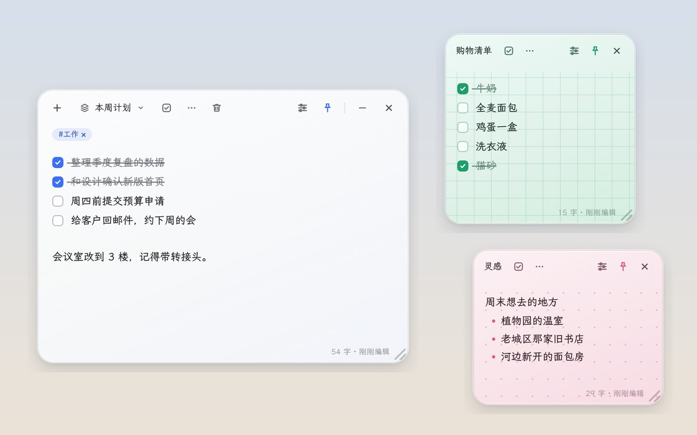
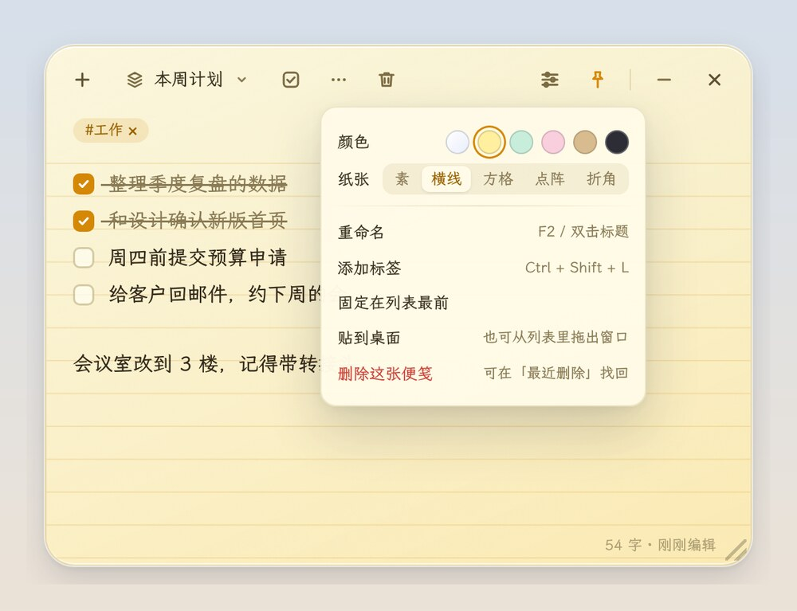
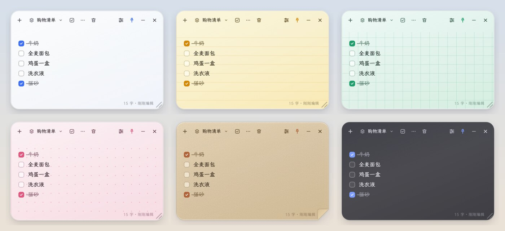
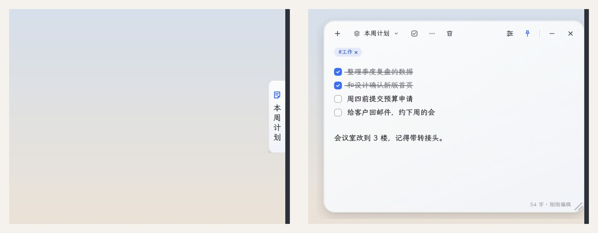

# FloatNote

一张浮在桌面上的半透明便笺：随手记、随时唤起、不打扰。全局快捷键唤起，待办、图片、标签混排，自动保存，支持多台电脑共用。



## 下载安装

到 [Releases](https://github.com/ttzttztt/FloatNote/releases/latest) 下载最新版本：

| 系统 | 文件 | 说明 |
| --- | --- | --- |
| Windows（推荐） | `FloatNote-Setup-x.y.z.exe` | 安装版，有新版本时自动更新 |
| Windows 免安装 | `FloatNote-x.y.z-portable.exe` | 双击即用，不自动更新 |
| Linux | `FloatNote-x.y.z-x86_64.AppImage` | 加上可执行权限后直接运行 |

第一次打开会有一张「欢迎使用 FloatNote」便笺，跟着里面的几条待办走一遍就会用了。

## 常见问题

- **Windows 提示「Windows 已保护你的电脑」**：安装包没有付费的代码签名，点「更多信息」→「仍要运行」即可。
- **更新后桌面图标还是旧的**：这是 Windows 的图标缓存没有刷新。从 v1.0.3 起安装程序会自动刷新；更早的版本可以按 `Win + R` 运行 `ie4uinit.exe -show`，或删掉桌面快捷方式后从开始菜单重新发送到桌面。
- **窗口找不到了**：按唤起快捷键（默认 `Ctrl+Alt+Space`）或单击托盘图标；托盘菜单里还有「找回窗口（移到屏幕中央）」。
- **便笺存在哪里**：只存在你自己的电脑上，不经过任何服务器，见下方「数据位置与多设备同步」。

## 功能

- **外观**：白色磨砂玻璃便笺——半透明玻璃 + 内阴影高光 + 细颗粒噪声，22px 圆角与柔和外阴影；工具栏为圆形主操作按钮（新建 / 隐藏 / 关闭）+ 胶囊便笺切换器 + 分组分隔线，图标统一 16px 线性风格；默认窗口为横向 700×380，可自由缩放。
- **第一次打开**：有一张「欢迎使用 FloatNote」便笺，用几条待办带你走一遍唤起快捷键、待办、换颜色、贴边、快速捕捉、贴到桌面；删掉后不会再出现。
- **系统集成**：设置里可开启「开机自动启动」；唤起 / 快速捕捉的全局快捷键可点击录制修改（与另一个重复或被占用时会提示并保留原设置，Backspace 恢复默认）。
- **唤起与窗口**：全局快捷键显示/隐藏（默认 `Ctrl+Alt+Space`）；点击工具栏空白区拖动窗口；四条边和四个角都能拖动调整大小；「窗口置顶」开关（工具栏图钉，让窗口总在其他窗口上方）；`—` 与 `✕` 均为隐藏到托盘，退出走托盘菜单。
- **配色主题**：白玻璃、暖黄便利贴、薄荷绿、樱花粉、牛皮纸、深色六种，每张便笺单独设置（工具栏「⋯」→ 颜色），切换菜单里以色点区分。



- **两个菜单**：工具栏「⋯」是这张便笺自己的设置（颜色、纸张、重命名、添加标签、固定在列表最前、贴到桌面）；右上角「设置」只放对所有便笺都生效的选项（外观、字号、透明度、窗口置顶、快捷键、便笺保存在哪里等），全部快捷键收在最下面的「全部快捷键」里。
- **界面细节**：鼠标移开卡片时工具栏淡出，只留内容（可在设置中关闭）；右下角状态栏显示「字数 · 编辑于 N 分钟前」；新建 / 切换便笺时内容轻微淡入；设置里可调字号（12–22px）。



- **纸与生命**：
  - 完成奖励：勾选待办时迸出几颗小圆点；一张便笺的待办全部完成时提示「全部完成，休息一下吧」；状态栏显示「今日完成 N 件」。
  - 纸张：素纸 / 横线 / 方格 / 点阵 / 折角（右下角真的折起来，露出桌面），另有牛皮纸颜色；每张便笺单独设置（「⋯」→ 纸张）。
  - 外观跟随：手动 / 跟随系统深色模式 / 跟随时间（早上 6–10 点偏暖，晚上 10 点到早上 6 点自动变暗）。
  - 撕掉与贴回：删除时便笺像便利贴一样被撕下来飞走，撤销时带回弹贴回来。



- **桌面上的便笺**：
  - 贴到桌面：点「⋯」→「贴到桌面」、切换菜单里每条的同名按钮，或把菜单里的便笺直接拖出窗口，它就变成桌面上一张独立的小便笺（位置、大小、是否置顶各自记住，重启后恢复）。多个窗口编辑同一份数据，实时同步；点小便笺的 ✕ 放回便笺本。
  - 贴边收起：把便笺本或桌面便笺拖到屏幕左 / 右 / 上边缘，鼠标移开后收成一条细边，鼠标碰到细边就滑出来；拖离边缘即取消（设置里可关闭）。贴边期间始终在最上层，不会被浏览器等窗口盖住；同一条边上的多条细边自动错开；重启后保持收起状态。
  - 快速捕捉：在任意程序里选中文字，按 `Ctrl+Alt+C`，文字连同来源窗口标题和时间追加到当前便笺。Windows 下会自动复制选中内容，并在捕捉后还原剪贴板；其他系统请先 `Ctrl+C` 再按快捷键。
- **便笺管理**：新建（`Ctrl+N`）、切换、搜索（`Ctrl+F`）、重命名、固定在列表最前、拖动排序、删除。删除的便笺进入「最近删除」（切换菜单底部），保留 30 天，可恢复或彻底删除；删除后底部提示条里也可直接撤销（提示条显示在状态栏的位置，不挡正文）。
  - 切换菜单顶部有搜索框（`Ctrl+F` 直接打开并定位到这里），按标题、正文、标签过滤；回车打开第一条，方向键在结果间移动。
  - 每条右侧的星标可把该便笺「固定在列表最前」，固定的始终排在前面；无搜索词时可拖动条目调整顺序（拖到固定区即自动固定）。（为避免混淆，「置顶」只指窗口总在其他窗口上方。）
  - 标题：默认取正文第一行；双击标题、按 `F2` 或点菜单里的笔形按钮可自定义，留空恢复自动标题。
  - 切换菜单：每项显示颜色、标题、正文预览、待办进度、标签与更新时间。
  - 空便笺自动清理：切走或重启时移除没有任何内容的便笺；当前便笺为空时点「新建」直接复用。
- **内容编辑**：文字自由编辑；Markdown 式快捷输入——行首输入 `[] `（或 `【】 `）变待办、`[x] ` 变已完成待办、`- ` 变列表、`1. ` 变编号列表、`# ` / `## ` 变标题；工具栏「待办」按钮或 `Ctrl+Shift+T` 把光标所在行或选中的多行转为待办，再按一次还原为普通文字；待办行内回车自动续一条新待办，空待办上回车退出（圆角主题色复选框，勾选后自动加删除线并保存）；在待办或列表的开头按一次 `Backspace` 就去掉复选框 / 圆点，文字留在原行；鼠标移到便笺上时标签栏出现「＋ 标签」，也可按 `Ctrl+Shift+L` 或「⋯」→「添加标签」，点击标签移除。
- **图片**：Ctrl+V 直接粘贴图片，或 `Ctrl+Shift+I` 读取剪贴板图片；长边超过 1920 像素的自动等比缩小并转成 WebP（一张 4K 截图约从 8MB 降到 0.5MB），GIF 原样保存；图片按便笺分目录落盘，重启后正常显示。
- **编辑体验**：
  - 撤销 / 重做（`Ctrl+Z` / `Ctrl+Y`）覆盖所有操作，包括待办切换、缩进、Markdown 快捷输入、粘贴、快速捕捉、插入图片；每张便笺各自记录（重启后清空）。
  - 粘贴网页 / Word 内容时只保留结构（段落、标题、列表、加粗斜体、链接），去掉字体、颜色、字号、背景等样式；`Ctrl+Shift+V` 只粘贴纯文本。
  - 链接：网址后敲空格或回车自动变成链接，粘贴的网址同样识别；按住 `Ctrl` 单击用系统浏览器打开（只放行 http / https / mailto）。
- **数据安全**：每天首次启动自动备份到 `backups/`，保留最近 7 天，托盘菜单「从备份恢复」可一键还原（还原前会把当前数据另存一份）；数据文件损坏时自动从最近的备份恢复，并把损坏文件改名留档；启动后自动清理没有便笺在用的图片。
- **持久化**：内容、标签、待办勾选状态、透明度、窗口置顶、窗口位置与大小、当前便笺均自动保存。

## 快捷键

| 操作 | 快捷键 |
| --- | --- |
| 显示 / 隐藏便笺 | `Ctrl+Alt+Space`（被占用时回退 `Ctrl+Shift+Space`、`Ctrl+Alt+F9`） |
| 新建便笺 | `Ctrl+N` |
| 搜索 / 切换便笺 | `Ctrl+F` |
| 重命名便笺 | 双击标题 / `F2` |
| 快速捕捉选中文字 | `Ctrl+Alt+C`（被占用时回退 `Ctrl+Shift+Alt+C`、`Ctrl+Alt+F10`） |
| 撤销 / 重做 | `Ctrl+Z` / `Ctrl+Y`（或 `Ctrl+Shift+Z`） |
| 粘贴纯文本 | `Ctrl+Shift+V` |
| 打开链接 | `Ctrl` + 单击 |
| 缩进 / 取消缩进 | `Tab` / `Shift+Tab`（缩进行开头按 `Backspace` 也会取消一级缩进） |
| 转为待办 / 还原 | `Ctrl+Shift+T` |
| 圆点列表 / 编号列表 | `Ctrl+Shift+8` / `Ctrl+Shift+7`，或行首输入 `- ` / `1. `（中文标点 `－`、`1。` 也可以）；列表开头按 `Backspace` 去掉圆点 |
| 添加标签 | `Ctrl+Shift+L` |
| 粘贴剪贴板图片 | `Ctrl+V` / `Ctrl+Shift+I` |

找不到窗口时的三种唤回方式：按全局快捷键、单击托盘图标、再次运行程序（单实例会把已有窗口唤到前台）；托盘菜单还有「找回窗口（移到屏幕中央）」，用于显示器变化导致窗口落在屏幕外的场景。

## 数据位置与多设备同步

应用完全在本机运行，不需要任何服务器。数据分两处保存：

| 内容 | 位置 | 是否随同步文件夹走 |
| --- | --- | --- |
| 便笺 `data.json`、图片 `images/` | **数据目录**，默认在本机目录；设置 →「便笺保存在」显示的就是它的完整路径，可以在那里换位置 | 是 |
| 本机设置 `local.json`（窗口位置、桌面便笺摆放、贴边状态、快捷键）、每日备份 `backups/`、数据位置记录 `location.json` | **本机目录** | 否，每台电脑各自一份 |

本机目录（默认也是数据目录）：

| 系统 | 路径 |
| --- | --- |
| Windows | `%APPDATA%\floatnote\`（通常为 `C:\Users\<用户名>\AppData\Roaming\floatnote\`） |
| macOS | `~/Library/Application Support/floatnote/` |
| Linux | `~/.config/floatnote/` |

**多台电脑共用便笺**：在每台电脑的设置 →「便笺保存在」→「换到同步文件夹…」里，选同一个 OneDrive / 坚果云 / iCloud 等同步文件夹（建议单独建一个，如 `OneDrive/FloatNote`）。

- 第一台电脑：选一个空文件夹，现有便笺和图片会复制过去，原位置保留不动。
- 第二台电脑：选同一个文件夹时会提示「合并两边的便笺」或「只用那里的便笺」。
- 之后每 2 秒检查一次，另一台电脑的修改会自动合并进来：同一张便笺两边都改过时取最后修改的；删除会记录下来，不会被另一台电脑带回来；同步软件产生的冲突副本（如 `data (1).json`）也会自动合并并改名为 `.merged`。
- 图片地址与目录位置无关（`fnimg://<便笺>/<文件>`），换目录、换电脑都能显示；旧版本保存的图片地址启动时自动转换。
- 设置里的「改回默认」可以搬回本机目录（会询问是否合并）。

备份或迁移时复制整个数据目录即可。

## 开发

下面是给想自己改代码、打包的人看的。

### 技术栈

| 项 | 选择 | 理由 |
| --- | --- | --- |
| 运行时 | Electron 45 | 原生支持全局快捷键、窗口置顶、透明窗口、剪贴板与无边框拖拽，与本地 Node 工具链一致 |
| 渲染 | 原生 HTML/CSS/JS（无框架） | 体积小、启动快，便于长期维护 |
| 字体 | 霞鹜文楷 屏幕阅读版（随应用打包） | 楷书手写感贴合便笺气质；SIL OFL 开源可商用；按 unicode-range 分片按需加载 |
| 存储 | JSON + 本地图片目录（userData） | 零依赖、可读、便于备份 |
| 窗口 | `transparent` + `frame:false` | 半透明圆角便笺外观 |

备选 Tauri 需 Rust 工具链；WPF/WinForms 做透明窗口与富文本混排成本更高，故选择 Electron。

### 运行

```bash
pnpm install         # 首次
pnpm start           # 或 pnpm dev；首次启动会下载 Electron 程序（约 100MB）
```

`scripts/start.js` 会清除 `ELECTRON_RUN_AS_NODE` 环境变量后再启动 Electron，避免终端环境把 Electron 当作纯 Node 运行。

项目使用 pnpm（`package.json` 中 `packageManager` 已锁定版本，启用 Corepack 后会自动使用对应版本）。

**Electron 下载源**：Electron 45 起不在 `install` 时下载程序，而是首次 `require('electron')`（即首次 `pnpm start`）时下载。默认源 GitHub 在国内常连不上（报 `fetch failed`），项目 `.npmrc` 已改用 npmmirror 镜像，`scripts/start.js` 启动时会读取它。想用其他源时，设置环境变量 `ELECTRON_MIRROR`（以及对应的 `ELECTRON_CUSTOM_DIR`）即可覆盖；若某次下载中断导致程序损坏，删除 `node_modules` 后重新 `pnpm install` 再启动。

`pnpm start -- <参数>` 会把参数透传给 Electron（如 Linux root 环境下的 `--no-sandbox`）。

### 测试

```bash
pnpm test            # Windows / macOS 直接运行
```

```bash
xvfb-run -a pnpm test   # Linux 无图形界面时
```

`tests/` 下是端到端测试：用 Playwright 驱动真实的 Electron 应用，每个测试文件使用独立的临时数据目录（`FLOATNOTE_USER_DATA`），不会碰到真实便笺。快速捕捉、真实按键唤起这类需要模拟系统按键的用例只在 Linux + xdotool 下运行，其他环境自动跳过。

每次推送和 PR 都会在 GitHub Actions 上自动跑一遍（`.github/workflows/test.yml`）。

### 打包

```bash
pnpm dist            # 打当前系统的安装包，输出到 release/
```

```bash
pnpm dist:win        # Windows：安装程序 FloatNote-Setup-x.y.z.exe（可选安装目录）+ 免安装便携版 FloatNote-x.y.z-portable.exe
```

- 打包时同样读取 `.npmrc` 里的国内镜像下载 Electron 与 NSIS 工具。
- Windows 安装包需要在 Windows 上打；也可以在 GitHub 仓库的 Actions →「打包」→ Run workflow，或推送 `v1.0.0` 这样的版本标签，自动在 Windows / Linux 上打包，产物在该次运行的 Artifacts 里下载。
- 安装版与开发版共用同一个数据目录，装上之后便笺都在。

### 发布新版本与自动更新

```bash
pnpm release patch   # 1.0.0 → 1.0.1；也可以写 minor / major，或直接写版本号 pnpm release 1.2.0
```

脚本会改好 `package.json` 的版本号、提交并打标签，然后按提示推送分支和标签。推送标签后，GitHub Actions（`.github/workflows/build.yml`）会：

1. 检查标签与 `package.json` 版本一致，创建草稿 Release；
2. 在 Windows / Linux 上打包，把安装包和更新信息（`latest.yml` 等）上传到这个 Release；
3. 两边都成功后正式发布。

已安装的 FloatNote（安装版、Linux AppImage）在启动 15 秒后及之后每 6 小时检查一次，有新版本就在后台下载，下载完弹出「重启更新」，不点的话下次退出时自动安装。设置面板里可以看到当前版本、手动检查更新。开发版（`pnpm start`）和便携版不会自动更新。

> 更新包从 GitHub 下载，国内网络下可能较慢或失败，失败时会在 6 小时后自动重试，也可以在设置里手动重试，或去 Releases 页面手动下载安装。

### 文件结构

```
main/main.js       主进程：数据（增量合并 + 广播）、便笺本与桌面便笺窗口、贴边收起、快速捕捉、托盘、全局快捷键
main/preload.js    contextBridge 暴露的受限 API
renderer/life.js   完成奖励、撕纸动画（纯表现层）
renderer/history.js 撤销 / 重做（按便笺的快照栈）
renderer/paste.js  粘贴清理、纯文本粘贴、链接识别
renderer/index.html 便笺结构
renderer/styles.css 便笺外观与动效
renderer/core.js   全局状态、DOM 引用、工具函数（最先加载）
renderer/sync.js   多窗口数据同步（按字段发送 / 合并增量）
renderer/notes.js  新建 / 删除 / 切换、最近删除、贴到桌面
renderer/appearance.js 主题、纸张、外观跟随、字号、状态栏
renderer/menu.js   切换菜单、重命名、标签、提示条
renderer/editor.js 待办、缩进、Markdown、图片、粘贴、链接、快捷键
renderer/window.js 窗口按钮、设置面板、拖动 / 缩放、贴边收起、快速捕捉
renderer/app.js    启动流程
renderer/fonts/    打包的字体（霞鹜文楷，附 OFL 许可证）
scripts/start.js   启动器（处理 ELECTRON_RUN_AS_NODE）
build/installer.nsh Windows 安装程序的补充脚本（安装 / 更新后刷新图标缓存）
docs/images/       README 里的截图
tests/             端到端测试（Playwright 驱动真实 Electron）
assets/icon.svg    图标源文件（48px 及以上用）；icon-small.svg 为 16–32px 简化版（托盘 / 任务栏）
assets/icon-*.png  各尺寸单独渲染的图标；icon.ico 打包了 16–256 各尺寸，供 Windows 使用
```

## 已知限制

- 全局快捷键可在设置面板里点击录制修改；首次启动若默认组合被占用，会依次回退到备用组合。
- 磨砂玻璃为 CSS 实现（半透明 + 高光 + 颗粒），透出桌面颜色与明暗，但**不模糊桌面内容**。实测本机 Electron 45 的 `backgroundMaterial: acrylic/mica` 渲染为不透明灰块（未采样背景），而 `desktopCapturer` 单帧耗时约 1 秒，无法用于实时底衬，故未采用真实背景模糊。
